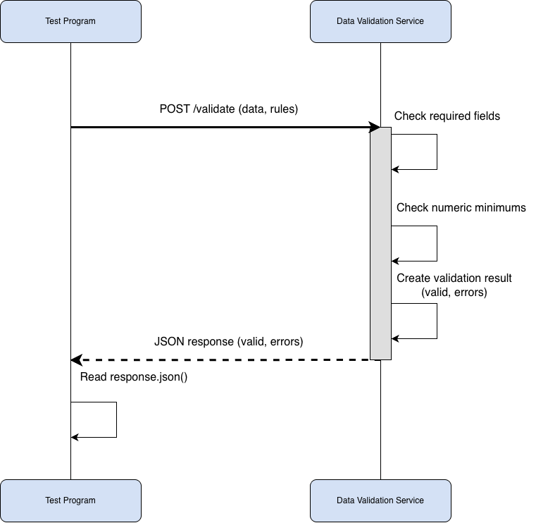

# Data Validation Microservice

This is a small Flask service for CS361 Assignment 7. The microservice checks required fields and numeric minimums, then returns the validation result as JSON.

The service is separate from the Perler Bead Inventory website. It does not use a database or a web page.

## What it checks

Send a POST request to `http://localhost:5001/validate`.

The JSON body has two objects:

- `data`: the values to check
- `rules`: the rules for each field

A field with `"required": true` must exist and must not be empty. An empty string, a string of only spaces, or a missing field is invalid. The number `0` is allowed because it is a real value.

A field with a `"min"` rule must be a number greater than or equal to that minimum. If `quantity` is `-10` and the minimum is `0`, the error is `quantity must be at least 0`. Text or other non-numeric values do not crash the service. They produce an error such as `quantity must be a number`. A missing or empty field is still reported only by the required-field check.

## Example request

```json
{
  "data": {
    "color_code": ""
  },
  "rules": {
    "color_code": {
      "required": true
    }
  }
}
```

## Example response

```json
{
  "valid": false,
  "errors": [
    "color_code cannot be empty"
  ]
}
```

When every required field is filled in, the response is:

```json
{
  "valid": true,
  "errors": []
}
```

## Python Communication Example

The microservice uses HTTP POST requests and JSON to communicate with other programs.

### Requesting Data

A client program can send application data and validation rules to the `/validate` endpoint using the Python `requests` library.

```python
import requests

url = "http://localhost:5001/validate"

payload = {
    "data": {
        "color_code": "H2",
        "quantity": -10
    },
    "rules": {
        "color_code": {"required": True},
        "quantity": {"required": True, "min": 0}
    }
}

response = requests.post(url, json=payload)
```

### Receiving Data

The microservice returns a JSON response containing two fields:

- `valid`: A Boolean indicating whether the data passed validation.
- `errors`: A list of error messages explaining which validation rules failed.

The client program can receive and read the returned data using:

```python
result = response.json()

print(result["valid"])
print(result["errors"])
```

For the example request above, the expected response is:

```json
{
    "valid": false,
    "errors": [
        "quantity must be at least 0"
    ]
}
```

`color_code` is filled in, so the required-field check passes. `quantity` is below the minimum, so that is the only error.

If all validation rules pass, the microservice returns:

```json
{
    "valid": true,
    "errors": []
}
```

## Install and run

From this folder:

```bash
python3 -m venv .venv
source .venv/bin/activate
pip install -r requirements.txt
python app.py
```

Leave that program running. In a second terminal, from the same folder:

```bash
source .venv/bin/activate
python test_client.py
```

`test_client.py` talks to the service with HTTP. It does not call the validation functions directly.

## UML Sequence Diagram

The diagram below shows how the test program
communicates with the Data Validation Microservice.

